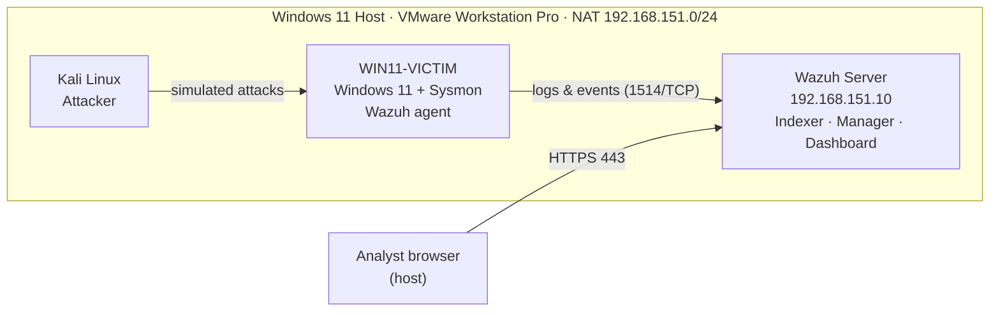

# Home SIEM Lab (Wazuh)

A virtual security operations lab built to practise threat detection and incident investigation.

**What it does:**
- Wazuh SIEM server collecting logs from Windows 11 and Linux endpoints
- Sysmon for detailed Windows process and network logging
- Simulated attacks (brute force, port scanning, privilege escalation) from a Kali Linux VM
- Custom Wazuh detection rules mapped to MITRE ATT&CK techniques
- Write-ups documenting each attack, what was detected, and detection gaps

**Tools:** Wazuh 4.x, Ubuntu Server 24.04, Windows 11, Sysmon, Kali Linux, VMware Workstation Pro

## Lab Architecture

**Status:** In progress